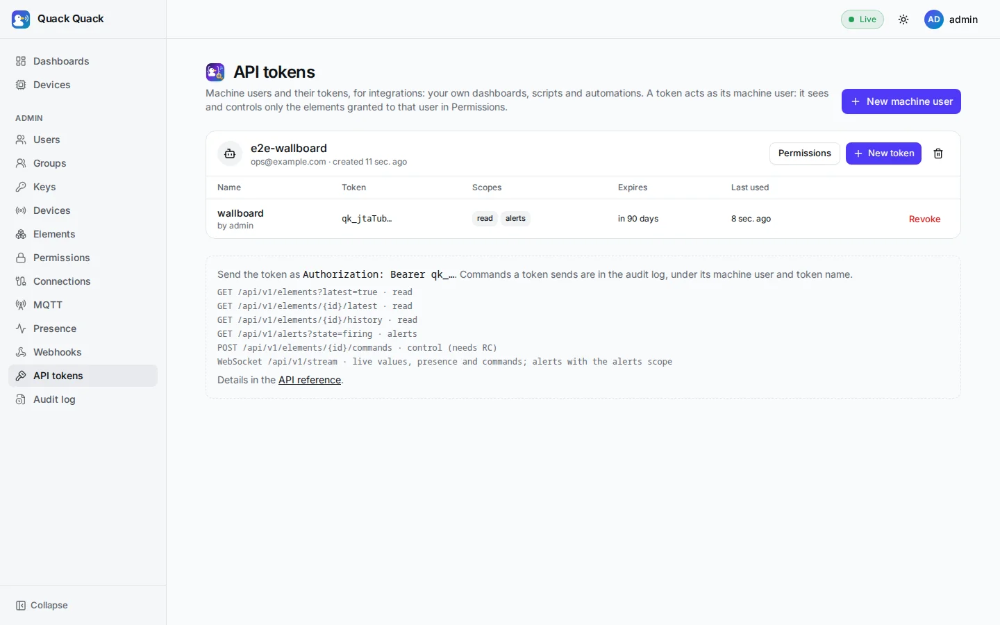
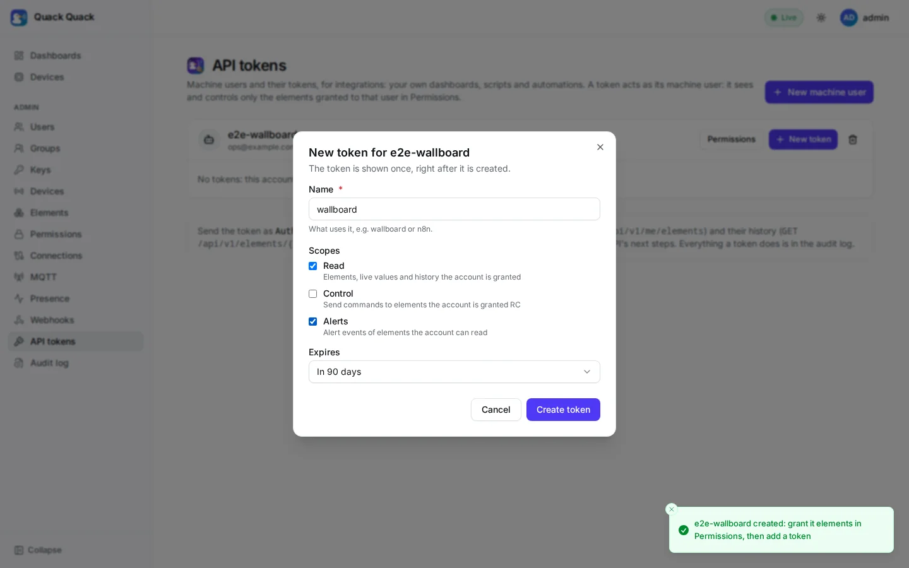
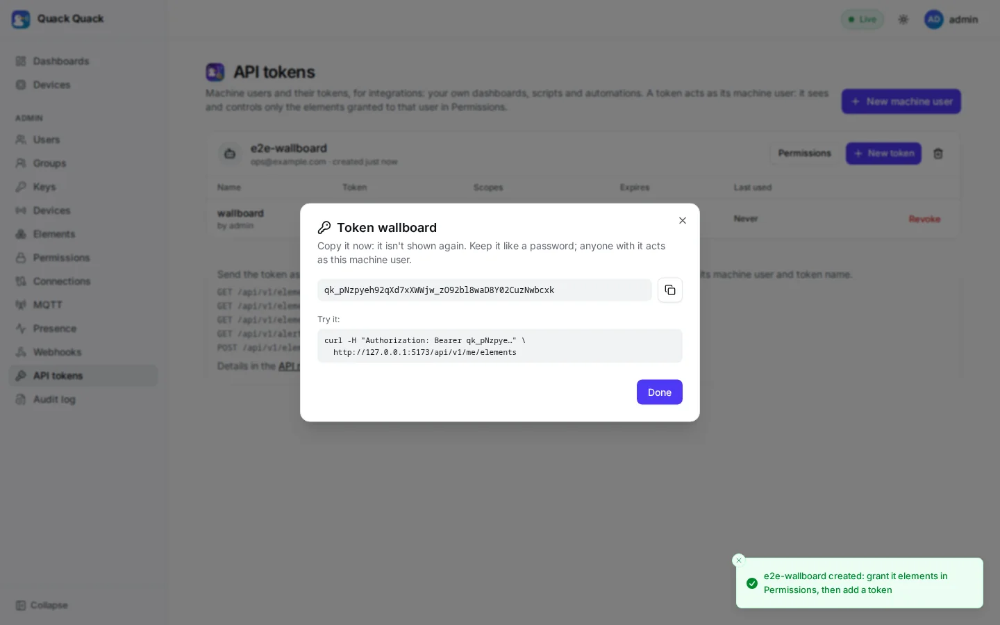

# API tokens

<p align="center">
  
</p>

API tokens let systems outside the platform use it without a browser session: your own dashboard on another site, a script, Node-RED, n8n, a cloud function or another business system. A token belongs to a **machine user** and can never do more than that account is granted.



> Tokens authenticate the [integration API](./integration_api.md): elements with their newest values, history, alerts and commands over REST, and a live [stream](./integration_api.md#stream) of values, presence and alerts over WebSocket.

## Machine users

A machine user is an account for one integration (`users.kind = 'service'`):

- It has **no password**: it can't sign in to the web app, and changing its password is refused.
- It is **never an admin**, and no admin endpoint accepts a token.
- It sees and controls **only the elements granted to it**, in **Admin → Permissions**, like any user (directly or through a group, `R` or `RC`).
- Deactivating it (Admin → Users) or deleting it stops all its tokens at once.

Create one per integration, so each can be granted and revoked on its own.

## Tokens

In **Admin → API tokens**: create a machine user, grant it elements in Permissions, then **New token**.

| | New token | Shown once |
|---|---|---|
| |  |  |

- **Scopes** restrict what a token may do on top of its account's grants:

  | Scope | Allows |
  |---|---|
  | `read` | Listing the account's elements, their live values and history |
  | `control` | Sending commands to elements the account is granted `RC` |
  | `alerts` | Alerts of the elements the account can read |

- **Expiry**: never, 30 or 90 days, or a year. An expired token stops working; the page marks it.
- The token (`qk_` followed by 43 characters) is shown **once**. Only its SHA-256 is stored, with its first characters (`qk_zDp8eC…`) so you can recognize it.
- **Last used** is updated at most once a minute.
- **Revoke** deletes it: the next request with it fails.
- A machine user has at most 20 tokens. Creating and revoking tokens, and every command a token sends, are in the audit log, without the token.

## Using a token

Send it in the `Authorization` header:

```bash
TOKEN=qk_…
curl -H "Authorization: Bearer $TOKEN" http://127.0.0.1:8080/api/v1/me/elements
curl -H "Authorization: Bearer $TOKEN" \
  "http://127.0.0.1:8080/api/v1/elements/$ELEMENT_ID/history?step=1h&from=2026-10-18T00:00:00Z"
```

```python
import requests

s = requests.Session()
s.headers["Authorization"] = f"Bearer {TOKEN}"
for el in s.get(f"{BASE}/api/v1/me/elements").json():
    print(el["name"], el["permission"])
```

| Endpoint | Scope |
|---|---|
| `GET /api/v1/elements` (`?latest=true`) | `read` |
| `GET /api/v1/elements/{id}/latest` | `read` |
| `GET /api/v1/elements/{id}/history` | `read` |
| `GET /api/v1/me/elements` | `read` |
| `GET /api/v1/alerts` | `alerts` |
| `POST /api/v1/elements/{id}/commands` | `control` |
| `GET /api/v1/stream` (WebSocket) | `read` for values, `alerts` for alerts, `control` for commands |

See the [integration API](./integration_api.md) for each one.

Every other endpoint answers `403 this endpoint isn't available to API tokens`, so a token can't reach dashboards, passwords or administration by accident. Each endpoint has to accept tokens explicitly.

| Answer | When |
|---|---|
| `401 invalid, expired or revoked API token` | Unknown, expired or revoked token, or an inactive machine user |
| `403 the API token lacks the read scope` | The token doesn't have the scope the endpoint needs |
| `403 this endpoint isn't available to API tokens` | The endpoint doesn't accept tokens |
| `404 not found` | An element the account isn't granted (same as for users) |

A request with a token is authenticated by the token alone: its cookies are ignored, and it skips the cross-origin (CSRF) check, since a browser never adds the header on its own.

## Keeping tokens safe

- Treat a token like a password. Prefer environment variables or a secret store to code.
- Give each integration its own machine user and the fewest grants and scopes it needs. A wallboard needs `read` only.
- Prefer an expiry, and revoke tokens you no longer use (look at **Last used**).
- A token in a web page's JavaScript can be read by anyone who opens the page. Use a read-only machine user for that, or put a small backend in front.

## API

| Endpoint | |
|---|---|
| `GET /api/v1/admin/machine-users` | Machine users with their tokens (never the secrets) |
| `POST /api/v1/admin/machine-users` | `{name, email?}` → `201` |
| `POST /api/v1/admin/machine-users/{id}/tokens` | `{name, scopes, expires_at?}` → `201` with `token`, the only time it is returned |
| `DELETE /api/v1/admin/machine-users/{id}/tokens/{tokenId}` | Revoke (`204`) |
| `DELETE /api/v1/admin/users/{id}` | Delete a machine user and its tokens |

These need an admin session.
