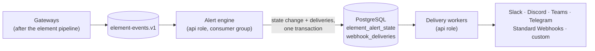
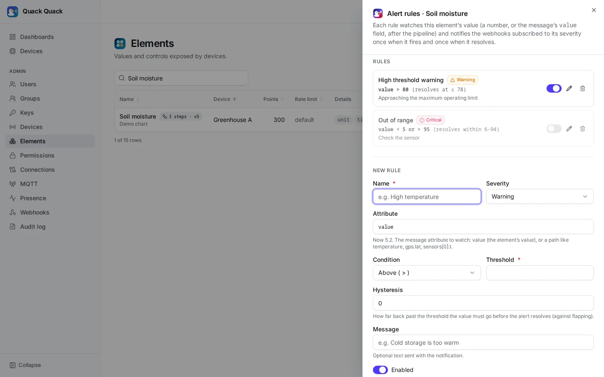
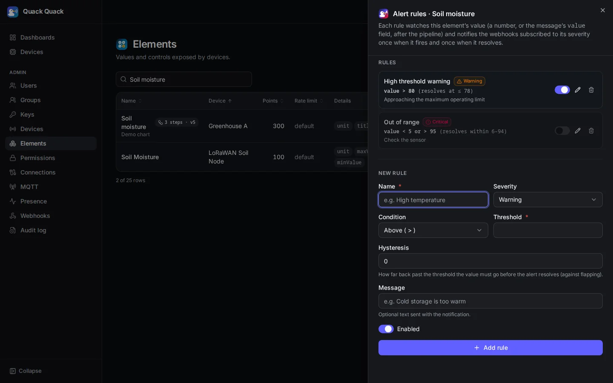
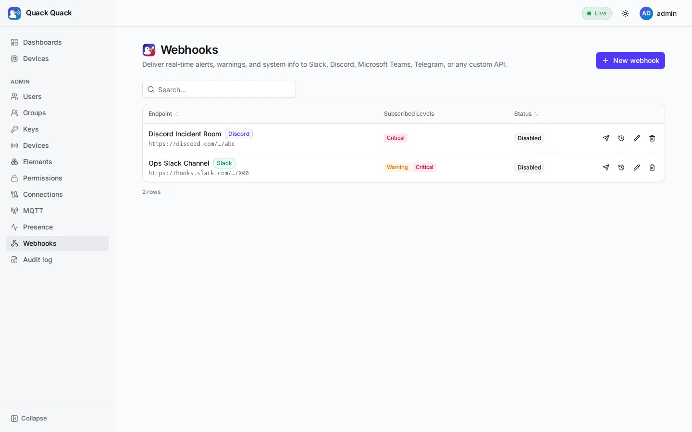
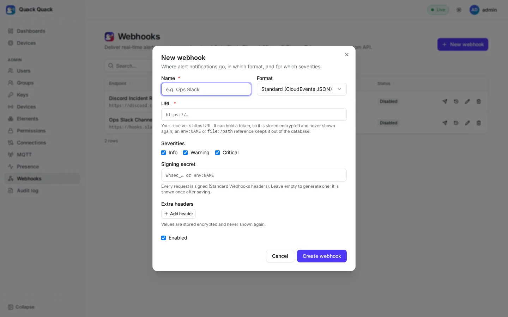

# Alerts and Webhooks

<p align="center">
  
</p>

**Alert rules** watch element values and notify **webhooks** once when a rule starts firing and once when it resolves. Webhooks can post to Slack, Discord, Microsoft Teams, Telegram, any receiver of signed JSON (Standard Webhooks), or a body built from your own template.

---

## 1. How it works



1. **Evaluation.** The alert engine runs in every `api` server, in the consumer group `QUACK_ALERT_GROUP` on `element-events.v1`. Each element's partition is read by one server, in order, so several api servers neither repeat nor miss an alert. A new group starts at the newest events (no replay of history).
2. **State.** Whether a rule is firing is kept in `element_alert_state`. A change of state and the deliveries it causes are written in **one transaction** (the state changes only if it still has the value read), so a restart or a retried batch neither repeats an alert nor loses a recovery.
3. **Queue.** One delivery is queued per enabled endpoint subscribed to the rule's severity (`webhook_deliveries`, unique per endpoint and event).
4. **Delivery.** Workers in every api server claim deliveries with a lease, oldest first per endpoint, and send them (see [§4](#_4-delivery-and-retries)).

The engine evaluates the element's value **after** the element pipeline: a bare number, a boolean (`true` = 1), or the `value` field of an object holding one. Other messages (text, objects without a numeric `value`) are ignored. Rule changes are picked up within 5 seconds.

---

## 2. Alert rules

Rules belong to an element: **Admin → Elements → Alerts**.

| Light | Dark |
|---|---|
|  |  |

### Conditions

| `condition` | Thresholds | Fires when |
|---|---|---|
| `above` | `threshold` | $v > T$ |
| `below` | `threshold` | $v < T$ |
| `outside_range` | `threshold` (low), `threshold_max` (high) | $v < T_{min}$ or $v > T_{max}$ |
| `equals` | `threshold` | $v = T$ |

`severity` is `info`, `warning` (the default) or `critical`. The firing **and** the resolved notification carry the rule's severity, with `state` = `firing` or `resolved`. `message` (optional, up to 500 characters) replaces the generated text of the firing notification. A rule can be disabled without deleting it (`enabled: false`).

### Hysteresis

A value hovering at a threshold would fire and resolve over and over. With a hysteresis $H$, a firing rule resolves only once the value is back past the threshold by $H$:

| Condition | Fires | Resolves |
|---|---|---|
| `above` 35, $H$ = 1 | $v > 35$ | $v \le 34$ |
| `below` 10, $H$ = 0.5 | $v < 10$ | $v \ge 10.5$ |
| `outside_range` 10–30, $H$ = 1 | $v < 10$ or $v > 30$ | $11 \le v \le 29$ |
| `equals` 50, $H$ = 5 | $v = 50$ | $\lvert v - 50 \rvert > 5$ |

For `outside_range`, $H$ must be less than half the range, or the rule could never resolve. The API refuses such a rule, and a `threshold_max` on any other condition.

Deleting or disabling a firing rule sends no "resolved" notification.

---

## 3. Webhooks

Endpoints are managed in **Admin → Webhooks**. Each one subscribes to some severities.

| Webhooks | New webhook |
|---|---|
|  |  |

### Formats

| `format` | For | Body |
|---|---|---|
| `standard` | Your own receiver, Zapier, Make… | CloudEvents 1.0 JSON; the notification is in `data` |
| `slack` | Slack incoming webhooks | Block Kit, colored by severity |
| `discord` | Discord webhooks | An embed, colored by severity |
| `teams` | Microsoft Teams (Workflows) | Adaptive Card 1.5 |
| `telegram` | Telegram Bot API `sendMessage` | HTML text to `options.chat_id` (required) |
| `custom` | Anything else | Your Go template (below) |

The notification (`data` of the standard format, and the fields a custom template sees):

```json
{
  "id": "0199…", "type": "io.quack.alert.threshold", "severity": "warning", "state": "firing",
  "rule_id": "…", "rule_name": "Hot", "title": "Alert: Hot", "message": "35 is above 30 (Cold room temperature)",
  "device_id": "…", "device_name": "Cold room", "element_id": "…", "element_name": "temperature",
  "value": 35, "timestamp": "2026-10-14T09:00:00Z"
}
```

A test from the admin UI (**Send test**) has `type` `io.quack.test.notification`.

### Custom templates

Go [`text/template`](https://pkg.go.dev/text/template) over the notification's fields (`.Title`, `.Message`, `.Severity`, `.State`, `.Value`, `.RuleName`, `.ElementName`, `.DeviceName`, `.Timestamp`…). The output must be valid JSON: write each value with `json` so it is quoted and escaped whatever it contains.

```
{"text": {{json .Title}}, "level": {{json .Severity}}, "value": {{json .Value}}}
```

`range` and nested templates aren't allowed, a missing field is an error, the template is at most 16 KiB and its output at most 64 KiB. A template is checked against a sample notification when it is saved.

### Secrets

The URL (Slack, Discord, Teams and Telegram URLs hold a token), the signing secret and header values are secrets:

- They are **never returned** by the API. An endpoint shows its URL redacted (`https://hooks.slack.com/…/X00`), its header names, and whether it has a secret.
- With `QUACK_SECRETS_KEY` (base64 of 32 bytes) they are stored encrypted (AES-256-GCM). Without it they are stored as written, and the server logs a warning at startup.
- Any of them can be an `env:NAME` or `file:/path` reference instead, resolved when sending and never stored resolved. References are shown, since they aren't secret.
- On update, an empty `url` or `secret` keeps the stored one, and an empty header value keeps that header's stored value. The `headers` map replaces the headers, so a header left out is removed.

### Signatures (Standard Webhooks)

Every request of an endpoint with a secret, whatever its format, is signed following [Standard Webhooks](https://www.standardwebhooks.com/):

| Header | |
|---|---|
| `webhook-id` | The notification id (the same on every attempt: use it to drop duplicates) |
| `webhook-timestamp` | When this attempt was sent, Unix seconds |
| `webhook-signature` | `v1,` + base64 of HMAC-SHA256 over `{webhook-id}.{webhook-timestamp}.{body}`, keyed with the base64 part of the `whsec_…` secret |

A new endpoint without a secret gets a generated one, returned **once** in the create response (and in the response of an update with `new_secret: true`); the admin UI shows it once to copy. Receivers should refuse timestamps more than 5 minutes from their clock:

```python
import base64, hashlib, hmac, time

def verify(secret: str, headers: dict, body: bytes, tolerance: int = 300) -> bool:
    msg_id, ts = headers["webhook-id"], headers["webhook-timestamp"]
    if abs(time.time() - int(ts)) > tolerance:
        return False  # too old or from the future: a replay
    key = base64.b64decode(secret.removeprefix("whsec_"))
    mac = hmac.new(key, f"{msg_id}.{ts}.".encode() + body, hashlib.sha256).digest()
    expected = "v1," + base64.b64encode(mac).decode()
    return any(hmac.compare_digest(expected, s) for s in headers["webhook-signature"].split())
```

Sign the raw body bytes as received, not re-encoded JSON.

### Where webhooks may go

A webhook can't be used to reach the platform's own network. URLs must be `https`, and the address a host name resolves to is checked when connecting: only public addresses (no loopback, private, link-local or metadata addresses). Redirects aren't followed, a request has 10 seconds, and only the first 2 KiB of a response is kept. `QUACK_WEBHOOK_ALLOW_PRIVATE=true` lifts the address check and allows `http`, for development only (`task dev` sets it so tests can use a local receiver).

---

## 4. Delivery and retries

- Each api server runs `QUACK_WEBHOOK_WORKERS` (default 4) deliveries at a time. A claimed delivery is leased for a minute: if its server dies, another one takes it over.
- Deliveries to one endpoint go out oldest first, one at a time, so a receiver gets them in order and an endpoint that is down delays only itself. Deliveries queued for a disabled endpoint wait until it is enabled again.
- A failed attempt is retried after $\min(10\,\text{s} \times 2^{n}, 1\,\text{h})$ ±20 %, or after the response's `Retry-After` (429/503) if longer, up to **8 attempts** in all.
- Retrying can't help with a 4xx other than 408 and 429, or with an endpoint whose URL or secret can't be resolved: those fail at once.
- Each delivery records its status (`pending`, `delivering`, `retrying`, `delivered`, `failed`), attempts, last HTTP status, error and latency; the admin UI shows them under **Delivery history**.
- Delivered and failed deliveries are deleted after `QUACK_WEBHOOK_RETENTION` (default 30 days).

---

## 5. REST API

All endpoints need an admin session.

### Alert rules

```http
GET    /api/v1/admin/elements/{id}/alerts            # the rules, each with "firing"
POST   /api/v1/admin/elements/{id}/alerts            # create, or update the rule named by "id"
DELETE /api/v1/admin/elements/{id}/alerts/{ruleId}
```

```bash
curl -X POST http://127.0.0.1:8080/api/v1/admin/elements/$ELEMENT_ID/alerts -b cookies.txt \
  -H 'Content-Type: application/json' \
  -d '{"name": "High motor temperature", "condition": "above", "threshold": 75, "hysteresis": 2,
       "severity": "critical", "message": "Motor temperature over its rated limit"}'
```

### Webhooks

```http
GET    /api/v1/admin/webhooks
POST   /api/v1/admin/webhooks                      # 201, with "secret" when one was generated
GET    /api/v1/admin/webhooks/{id}
PUT    /api/v1/admin/webhooks/{id}
DELETE /api/v1/admin/webhooks/{id}
POST   /api/v1/admin/webhooks/{id}/test            # {"severity": "info"} → status_code, latency_ms, response, success, error
GET    /api/v1/admin/webhooks/{id}/deliveries?limit=50   # 1–500
```

```bash
curl -X POST http://127.0.0.1:8080/api/v1/admin/webhooks -b cookies.txt \
  -H 'Content-Type: application/json' \
  -d '{"name": "Production alerts", "url": "env:SLACK_ALERTS_URL", "format": "slack",
       "severities": ["warning", "critical"]}'
```

```bash
# Telegram: the bot token is in the URL, the chat in options
curl -X POST http://127.0.0.1:8080/api/v1/admin/webhooks -b cookies.txt \
  -H 'Content-Type: application/json' \
  -d '{"name": "On-call", "url": "https://api.telegram.org/bot'"$BOT_TOKEN"'/sendMessage",
       "format": "telegram", "options": {"chat_id": "-1001234567890"}, "severities": ["critical"]}'
```

Changes to rules and endpoints are recorded in the audit log, without secret values.

---

## 6. Metrics

| Metric | Type | Labels | |
|---|---|---|---|
| `quack_webhook_deliveries_total` | counter | `result` = `delivered` \| `retry` \| `failed` | Delivery attempts |
| `quack_webhook_queue` | gauge | | Deliveries not yet delivered or failed |
| `quack_alert_transitions_total` | counter | `state` = `firing` \| `resolved` | Rules that started firing or resolved |
| `quack_alert_errors_total` | counter | | Evaluation batches that failed (and were retried) |
